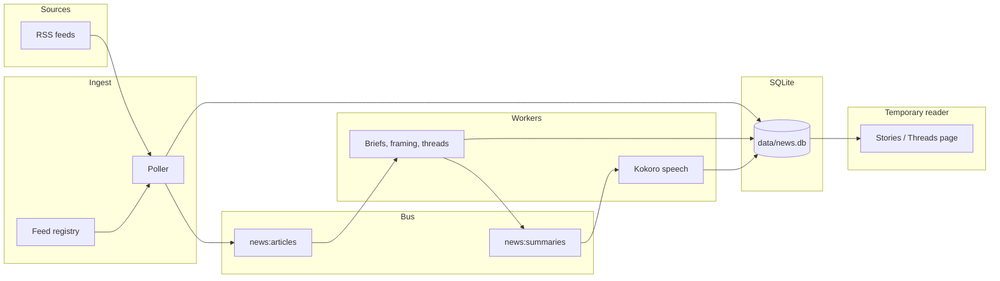

# Architecture

This project is a Canadian news middleman. It polls RSS feeds, keeps one copy of each story, writes a short brief, and groups reports that belong together. The page at `http://127.0.0.1:8765` is a temporary reader for checking that work. The briefs, comparison notes, and threads are the product. A phone app is the intended client later.

## Map



Three asyncio tasks run for the life of the process: the poller, the AI worker, and the speech worker. The reader is a small HTTP server on a background thread. They share one SQLite database and one Redis Streams broker.

## What starts

`python -m news_pipeline.main` does this in order:

1. Open `data/news.db`, create tables, and add any columns that older databases lack.
2. Upsert the feed catalog from `news_pipeline/config.py` into `feeds`.
3. Backfill older rows: fill missing outlet and place labels, assign cluster ids, regroup recent headlines, and clean thread rows.
4. Connect to Redis at `REDIS_URL`. If nothing answers, use an in-process Redis with the same stream commands.
5. Create consumer groups `ai-workers` on `news:articles` and `tts-workers` on `news:summaries`.
6. Serve the reader at `http://127.0.0.1:8765`.
7. Start the three workers.

Ctrl+C stops the workers and closes the database.

## Feed registry

Each feed is a name, URL, outlet, topic, place, and poll interval. Topic is the chip on Stories (`Top`, `Canada`, `Local`, `World`, `Politics`, `Business`, `Health`, `Arts`, `Technology`, `Sports`). Place is a province or a city (`Canada`, `Manitoba`, `Winnipeg`, and so on). City feeds use the city so a reader in Winnipeg can separate that city from the rest of the province.

National desks poll about every two to five minutes. City and regional feeds poll about every ten minutes. The catalog is the list in `news_pipeline/config.py`. A feed is added by putting a working RSS URL in that list and restarting. CTV’s public RSS addresses currently return 404, so CTV is not in the catalog.

The poller only fetches feeds whose interval has elapsed. On a changed feed it saves at most two new articles (`MAX_NEW_ARTICLES_PER_POLL`). The rest wait for the next poll so the local model does not fall behind.

## One story, from feed to brief

1. **Fetch.** The poller sends `If-None-Match` and `If-Modified-Since`. A 304 or an unchanged body hash ends the poll.
2. **Parse.** `feedparser` reads entries. The same URL already stored on this feed is skipped. The same URL already stored from another feed is linked in `article_feeds` and is not summarized again.
3. **Text.** The RSS summary or `content:encoded` is the article text when it is at least 500 characters. Shorter entries get one HTML fetch, and the story body is extracted from the page.
4. **Claim.** Redis keys `seen:url` and `seen:title` are scoped to the feed (`feed id + url`, `feed id + title`) and expire after seven days. A second outlet can still publish its own report of the same event.
5. **Store.** `insert_article` writes the row with the feed’s outlet, topic, and place. Headlines that match `same_story` share a `cluster_id`. A later headline can pull an older match into its cluster.
6. **Publish.** The new row id goes on the `news:articles` stream.
7. **Brief.** The AI worker reads one message, asks Ollama (`llama3.1:8b` by default) for about 50 plain words, and saves `summary`, `summary_words`, and `summary_engine`. Story cards, comparisons, and threads show that brief. If Ollama is down or the reply is too short, an extractive brief is cut from the article text.
8. **Ack.** The stream message is acknowledged. Stories still missing a brief are put back on the stream at startup.

`same_story` compares content words in the two headlines. It needs a real overlap. Two shared names are not enough, and a one-word swap such as “holds” versus “cuts” stays two stories.

## Three readings of the same rows

| Reading | When it appears | What it is |
| --- | --- | --- |
| Stories | Every stored article | One card: outlet, time, headline, and the brief. Filter by topic and place. |
| Compare | Two or more outlets share a `cluster_id` | One card for the event. After each outlet has a brief, the model writes one sentence on what that outlet led with. Those sentences are stored in `framings` and rewritten when a brief changes. |
| Threads | At least two articles on one open situation | A situation over time. The model answers `IGNORE`, `OPEN`, or `UPDATE` for each new brief. A later report is added to the open thread. A known outcome closes it. A single story stays on Stories. |

Compare is the same moment from two newsrooms. A thread is the same situation as later reports arrive. Startup merges open threads whose headlines match, drops updates that do not belong, and attaches other articles already in that story’s cluster.

Thread decisions are judged once per article (`thread_reviews`). When the article stream is empty, the AI worker judges one stored brief that has not been reviewed yet.

## Speech

The speech worker listens on `news:summaries`. When Kokoro-82M is installed it writes `data/audio/<id>.wav` from the brief. When it is not installed, the worker records that once and leaves audio empty. Speech is optional and is not required for briefs, comparisons, or threads.

## Stores

**SQLite** (`data/news.db`, WAL) is the system of record.

| Table | Holds |
| --- | --- |
| `feeds` | Catalog row plus the last ETag, body hash, status, and poll time |
| `articles` | One story: url, title, text, brief, cluster, outlet, place, audio |
| `article_feeds` | Which feeds carried that story |
| `framings` | Comparison sentences for a cluster |
| `threads`, `thread_updates`, `thread_reviews` | Open situations and which articles were already judged |
| `events` | Last 200 stage messages shown on the page |
| `runtime` | Broker label, model name, speech status |

**Redis Streams** only moves work between the poller and the workers. The reader never reads Redis. It reads SQLite. Missing Redis does not stop the pipeline; `fakeredis` stands in for the process.

## Modules

| Module | Job |
| --- | --- |
| `main.py` | Start database, broker, reader, and the three workers |
| `config.py` | Feed catalog, topics, places, model, Redis, and poll limits |
| `database.py` | Schema, feed schedule, clusters, framing rows, threads |
| `poller.py` | Fetch RSS, dedupe, enrich text, publish new stories |
| `broker.py` | Redis or in-process streams, plus seen-keys |
| `normalize.py` | URLs, headline matching, HTML to text, brief cleanup |
| `worker_ai.py` | Briefs, then framing, then thread decisions |
| `framing.py` | One sentence per outlet for a compared story |
| `threads.py` | Ask the model whether a brief opens, continues, or ignores a situation |
| `worker_tts.py` | Optional Kokoro audio |
| `ui.py` | Temporary page and `/api/snapshot` |

The page polls `/api/snapshot` every two seconds and rebuilds Stories or Threads from that JSON. Stories and Threads are separate views. Topic and place filters apply to Stories only.

## Settings

| Variable | Default | Effect |
| --- | --- | --- |
| `OLLAMA_URL` | `http://127.0.0.1:11434` | Ollama chat API |
| `OLLAMA_MODEL` | `llama3.1:8b` | Briefs, framing, and thread decisions |
| `REDIS_URL` | `redis://127.0.0.1:6379/0` | Stream broker; falls back to in-process Redis |
| `KOKORO_VOICE` | `af_heart` | Used only when Kokoro is installed |

Run from the project root:

```text
python -m venv .venv
.\.venv\Scripts\Activate.ps1
pip install -r requirements.txt
python -m news_pipeline.main
```

Then open `http://127.0.0.1:8765`.
