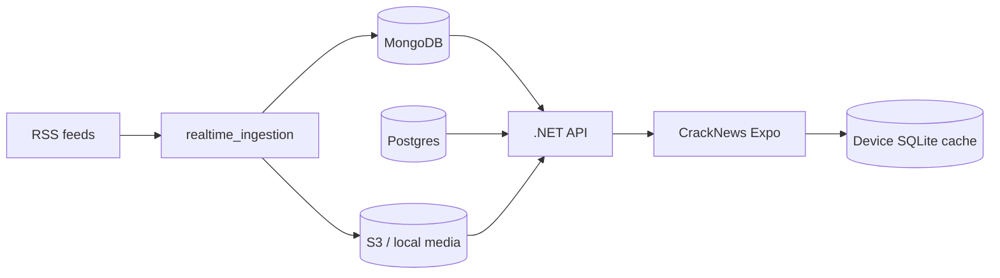

# Developer handbook — CrackNews

How to run, smoke-test, and extend the three independent projects.  
For **what already shipped**, see [SHIPPED.md](./SHIPPED.md). For **future personalization**, see [upgrade-plan.md](./upgrade-plan.md).

---

## Repo layout

```text
cnews/
├── docs/real-time-ingestion/   # Specs + this handbook
├── realtime_ingestion/         # Python: RSS → brief → TTS → Mongo/S3
├── backend/                    # .NET 10 API (Kestrel / Lambda)
├── mobile/                     # Expo / React Native (CrackNews)
├── scripts/                    # seed_demo_mongo, seed_demo_ads, brief generators
├── docker-compose.yml
└── .env.example
```

**Contracts**

- Mobile ↔ API: [api.md](./api.md)
- Ingest ↔ API stores: [data-model.md](./data-model.md)
- Product UX: [mobile.md](./mobile.md) (update when behavior changes)
- Delivery status: [SHIPPED.md](./SHIPPED.md) · [roadmap.md](./roadmap.md)

---

## Prerequisites

| Tool | Use |
| --- | --- |
| Docker Desktop | Mongo, Postgres, Redis (+ MinIO optional) |
| .NET 10 SDK | `backend/` |
| Node 20+ | `mobile/` |
| Expo Go **or** dev client | Phone preview (background audio needs **dev client / rebuild**) |
| Python 3.11+ | Live ingest |
| Ollama + `llama3.1:8b` | Live briefs |
| Kokoro + ffmpeg | Live Opus (optional) |

---

## Day-one runbook (demo without Ollama)

### 1. Infra + seed

```bash
cp .env.example .env
docker compose up -d mongo postgres redis
python3 scripts/seed_demo_mongo.py
python3 scripts/seed_demo_ads.py
# optional spoken demos:
#   scripts/generate_demo_briefs.sh  or Kokoro generator
```

### 2. API (LAN)

```bash
export PATH="$HOME/.dotnet:$PATH"
cd backend
PUBLIC_BASE_URL=http://<YOUR_LAN_IP>:5080 \
  ASPNETCORE_ENVIRONMENT=Development \
  dotnet run --project CNews.Api --urls http://0.0.0.0:5080
```

Smoke:

```bash
curl -s http://127.0.0.1:5080/v1/health
curl -s 'http://127.0.0.1:5080/v1/home/feed?limit=5&mode=listen' | head
curl -s 'http://127.0.0.1:5080/v1/ads/display?slot=home_wall&limit=6'
curl -s 'http://127.0.0.1:5080/v1/search?q=calgary&mode=listen'
curl -s 'http://127.0.0.1:5080/v1/storylines?status=open&limit=5'
```

### 3. Mobile

```bash
cd mobile
# set EXPO_PUBLIC_API_BASE_URL=http://<YOUR_LAN_IP>:5080  (app.json extra or .env)
npm install
npx expo start --lan
```

Phone and laptop on the **same Wi‑Fi**. Do **not** use `localhost` on a physical device.

### 4. Auth bypass (dev)

```bash
curl -s -X POST http://127.0.0.1:5080/v1/auth/google \
  -H 'Content-Type: application/json' \
  -d '{"idToken":"dev:you@example.com"}'
```

App Login tab uses the same `dev:` path via the Google stub.

---

## Live ingest (optional)

```bash
ollama pull llama3.1:8b
python3 -m venv .venv && source .venv/bin/activate
pip install -r realtime_ingestion/requirements.txt
# configure .env: MONGODB_URI, REDIS, S3_*, TTS_ENABLED, …
python -m realtime_ingestion.main
```

Ops UI: `http://127.0.0.1:8765`

---

## Background audio (lock screen)

Configured in:

- `mobile/app.json` → `expo-audio` plugin `enableBackgroundPlayback: true`
- `playerStore` → `shouldPlayInBackground: true` + `setActiveForLockScreen`

**Requires a native rebuild** after changing the plugin (`npx expo prebuild` / EAS / custom dev client). Expo Go alone will not keep audio when the screen locks.

---

## Release builds (EAS)

Profiles live in `mobile/eas.json`:

| Profile | For | API | Crash reports |
| --- | --- | --- | --- |
| `development` | Dev client on your phone (background audio, lock screen) | LAN `http://` | Off |
| `preview` | Internal testers (Android `.apk`, iOS ad hoc) | `https://` | On |
| `production` | App Store / Play Store; build number auto-increments | `https://` | On |

Release builds block plain `http://`, so `preview` / `production` need the API (and the
media / audio URLs from `PUBLIC_BASE_URL`) on a public HTTPS domain. Replace the
placeholder `https://api.cracknews.ca` in `eas.json` with the real one.

One-time setup:

```bash
cd mobile
npx eas-cli@latest login
npx eas-cli@latest init                 # links the project, writes extra.eas.projectId to app.json
npx eas-cli@latest build:version:set    # only if a build is already in a store
# Crash reporting (sentry.io → project → Client Keys / Auth Tokens):
npx eas-cli@latest env:set --name EXPO_PUBLIC_SENTRY_DSN --value <dsn> --environment production --visibility plaintext
npx eas-cli@latest env:set --name EXPO_PUBLIC_SENTRY_DSN --value <dsn> --environment preview --visibility plaintext
```

Add `SENTRY_AUTH_TOKEN` (source map upload) in the Expo dashboard → project →
Environment variables, visibility **Secret**, for `preview` and `production`.

Set `SENTRY_ORG` / `SENTRY_PROJECT` in `eas.json` to your Sentry slugs. Signing keys:
the first `eas build` offers to generate and store them (Android keystore, iOS
certificates); keep them EAS-managed.

```bash
npx eas-cli@latest build --profile preview --platform android
npx eas-cli@latest build --profile production --platform all
npx eas-cli@latest submit --profile production --platform ios   # or android
```

### Ads (Google AdMob, non-personalized)

Home and Storylines ad slots show Google **native** ads drawn like the app's cards
(`src/features/ads/`). Rules baked in: non-personalized requests only, so there is
**no tracking prompt** (no `NSUserTrackingUsageDescription`); never in Play; a slot only
appears once an ad has loaded; first-party ads from `/v1/ads/display` win when present.
Expo Go and web skip ads entirely. Dev and preview builds always show Google test ads.

For real ads (no bank card needed until payout, ~$100):

1. admob.google.com → add the app (iOS, and Android if released) → create a **Native
   advanced** ad unit for each.
2. In `mobile/eas.json` → `production.env`, fill `ADMOB_IOS_APP_ID` /
   `ADMOB_ANDROID_APP_ID` (App IDs, `ca-app-pub-…~…`) and `EXPO_PUBLIC_ADMOB_NATIVE_IOS` /
   `EXPO_PUBLIC_ADMOB_NATIVE_ANDROID` (ad unit IDs, `ca-app-pub-…/…`). Empty = test ads.
3. Release in **Canada only** (App Store Connect → Pricing and Availability) unless you
   add Google's consent form for the EEA/UK.
4. App Privacy: Data Not Linked to You → Location (coarse), Identifiers (Device ID),
   Usage Data (Advertising Data), Diagnostics; Tracking: **No**. Privacy policy: say the
   app shows non-personalized Google AdMob ads and Google may collect device data
   (e.g. IP address) to deliver and measure them.
5. Optional, for full demand: publish `app-ads.txt` on your developer website.

Don't run `scripts/seed_demo_ads.py` against production: its demo ads use real brands.

`app.json` `version` is the user-facing version (bump it per release); build numbers
are managed remotely by EAS.

## Common workflows

### Add a feed story (seed)

Edit / re-run `scripts/seed_demo_mongo.py`, ensure covers under `backend/CNews.Api/wwwroot/media/covers/` and audio under `wwwroot/media/` (or S3 keys).

### Add a display ad (seed)

Edit / re-run `scripts/seed_demo_ads.py`. Images live under `backend/CNews.Api/wwwroot/media/ads/display/`. Slots: `home_wall`, `storylines_list`. Ads are **not** mixed into `/v1/home/feed`.

### Change Play behavior

| Concern | File |
| --- | --- |
| Surface ownership | `playSurfaceStore.ts` |
| Queue / audio / lock screen | `playerStore.ts` |
| Button logic | `PlayTabButton.tsx` |
| Stop on leave page | `useFocusEffect` cleanup in Home / Storylines / Settings / Login / readers |

### Change Storyline timeline UI

`mobile/src/features/storylines/StorylineReaderScreen.tsx`  
Stamps: `formatTimelineStamp` in `shared/utils/time.ts`

### Pagination

| Surface | Hook | API |
| --- | --- | --- |
| Home | `useFeed` | `GET /v1/home/feed?mode=listen&cursor=` |
| Storylines | `useStorylines` | `GET /v1/storylines?cursor=` |
| Display ads | `useFeed` / `useStorylines` | `GET /v1/ads/display?slot=` |
| Search | `useSearch` | `GET /v1/search?q=` |

Pull-to-refresh: fetch first page + `shuffleCopy` (not `newerThan` merge).

### Backend tests

```bash
cd backend
dotnet test
```

---

## Environment cheat sheet

| Variable | Where | Purpose |
| --- | --- | --- |
| `PUBLIC_BASE_URL` | API process | Absolute media / audio URLs for phones |
| `EXPO_PUBLIC_API_BASE_URL` | Mobile | API host for Expo |
| `MONGODB_URI` | Ingest + API | Content |
| `ConnectionStrings__Postgres` / env | API | Users |
| `JWT_SIGNING_KEY` | API | Session tokens |
| `TTS_ENABLED` | Ingest | Kokoro path |
| `S3_*` | Ingest + API | Audio object store |

See `.env.example` and [local-development.md](./local-development.md).

---

## Architecture (runtime)



**Play surfaces**

```text
Home focused     → context wall       → startWallQueue(visible ids)
Storylines focused → context storylines → startStorylineQueue(thread or list)
Blur / other tab → stop()
Original WebView → pause; close → resume if was playing
```

---

## Definition of done — local demo

1. Seeded feed paints on Home masonry (voice-ready). Display ads may appear as labeled cards.
2. Play speaks **story** briefs with card highlight; ads are skipped; advances left→right.
3. Reader + Original WebView work above the tab bar; Play pauses/resumes around Original.
4. Storylines list paginates (ads may appear); timeline shows stamps + connected nodes; Original pause/resume works.
5. Leaving a tab stops Play; Play on the new tab starts that page’s queue.
6. Search finds a seeded story; Play speaks those hits.
7. Settings topics filter feed.

---

## Doc ownership

When you change product behavior, update in the same PR:

1. [SHIPPED.md](./SHIPPED.md) — what shipped  
2. [mobile.md](./mobile.md) or [api.md](./api.md) — contract/UX  
3. [roadmap.md](./roadmap.md) checkboxes if a milestone moved  
4. This file if runbooks or env vars changed  
