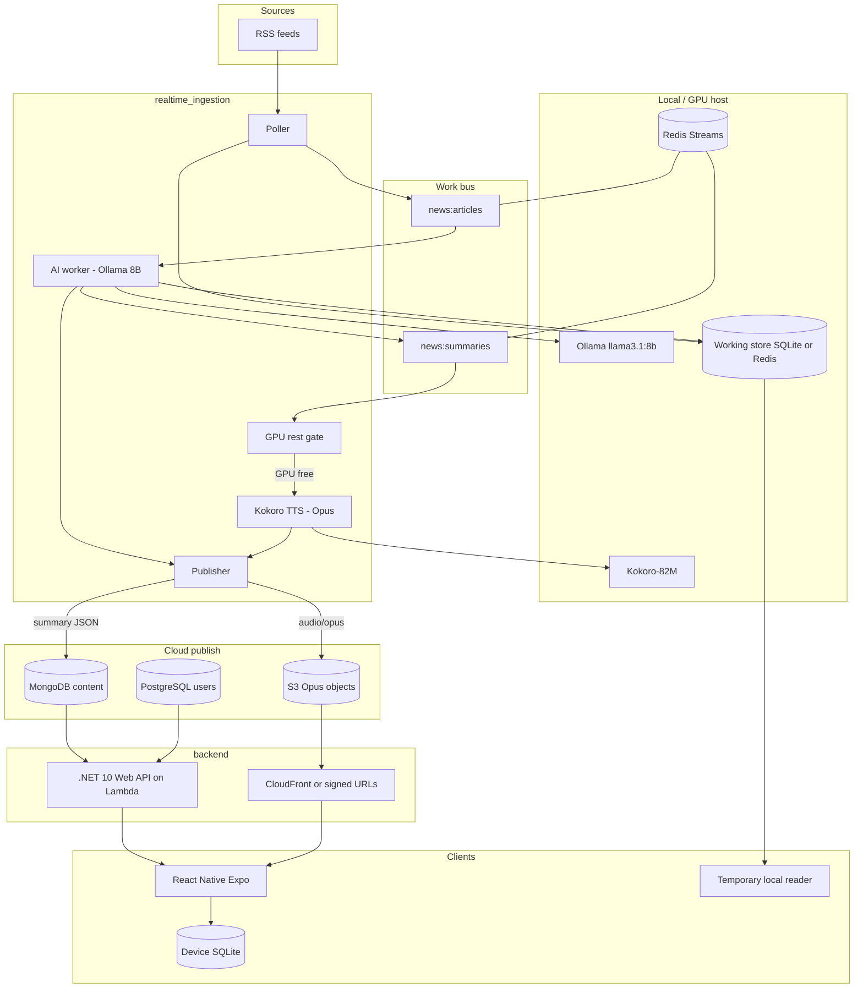
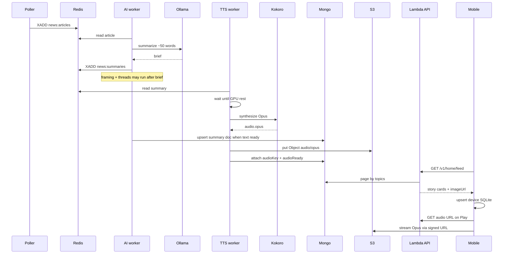

# Architecture

## Purpose

Build a Canadian news middleman: poll RSS feeds, keep one copy of each story, write a short brief with a local LLM, group reports that belong together, speak the brief when a GPU is free, then publish text and audio for a mobile app.

Today the pipeline still uses a local SQLite database and a temporary results page at `http://127.0.0.1:8765`. The target architecture below is what we are building toward. See [roadmap.md](./roadmap.md) for the migration path.

## Target system map

## Responsibilities

### `realtime_ingestion` (Python)

- Own feed registry, polling, dedupe, clustering, briefs, framing, threads.
- Call Ollama for text work (briefs, framing sentences, thread decisions).
- Call Kokoro only after the brief exists **and** the GPU is idle.
- Publish ready stories: summary document → MongoDB; Opus file → S3.
- Keep a working store for in-flight work and the temporary reader.
- Never expose MongoDB or S3 credentials to the mobile app.

### `backend` (.NET 10 Web API → AWS Lambda)

- Read API over published MongoDB documents (stories, coverage, storylines).
- Auth + profile API against **PostgreSQL** (Google Sign-In).
- Issue short-lived audio URLs (signed S3 or CloudFront).
- Filter feeds by topic preferences (query and/or stored user prefs).
- Deploy as a container image to Lambda; locally emulate with Docker + Lambda RIE.

### Mobile (React Native + Expo Go)

- Immersive Home wall (masonry) → full-screen reader; Coverage = horizontal outlet swipe (no Coverage tab).
- Tabs: Home · Play · Storylines · Settings.
- Stack: latest React Native / Expo, **HeroUI Native**, **Zustand**, on-device **SQLite** + remote API.
- Talk only to the backend API. Never talk to Ollama, Redis, or the GPU host.

## End-to-end story lifecycle

Exact publish ordering rules are in [pipeline.md](./pipeline.md).

## Layering

| Layer | Technology | Notes |
| --- | --- | --- |
| Ingest + AI + TTS | Python, asyncio, Redis Streams | Runs on a GPU-capable host (local machine or GPU instance) |
| LLM | Ollama + `llama3.1:8b` | Required for quality briefs; extractive fallback only for resilience |
| Speech | Kokoro-82M → Opus | Optional for text-only publish; preferred for mobile listen mode |
| Working store | SQLite today | May remain for pipeline ops; not the mobile source of truth |
| Publish store | MongoDB | Stories, coverage (compares), storylines the API serves |
| User store | PostgreSQL | Google identity, topic preferences |
| Media store | AWS S3 | Opus blobs; app never gets a permanent public bucket listing |
| API | ASP.NET Core (.NET 10) on Lambda (container) | Stateless; scales with traffic |
| Client | React Native / Expo / HeroUI Native / Zustand | Immersive wall + full-screen + Play |
| Client cache | SQLite on device | Feed cards + prefs mirror; audio stays remote |

## Why this split

- **GPU work stays off Lambda.** Ollama and Kokoro need sustained compute and often a GPU. Lambda is a poor place for that.
- **Mobile stays thin.** The app asks for cards and audio URLs. It does not know about feeds or models.
- **Publish is intentional.** A story reaches users only after the publish gate passes, so Home never shows half-built briefs without their promised audio state.

## Current vs target (short)

| Concern | Current | Target |
| --- | --- | --- |
| Brief storage | Pipeline SQLite `articles.summary` | MongoDB `stories` (+ device SQLite cache) |
| Audio | Optional local WAV | Opus in S3; MongoDB holds `audioKey` |
| TTS timing | Stream consumer when Kokoro installed | After brief + GPU rest gate |
| Client | Local HTML reader | Expo wall → full-screen (+ coverage swipe) + Storylines |
| Users | — | Google Sign-In → PostgreSQL |
| API | `/api/snapshot` on local process | Versioned REST under `/v1` |

The temporary reader remains useful for watching the pipeline. It is not a substitute for the mobile UX described in [mobile.md](./mobile.md).

## Trust and security boundaries

- RSS fetch and HTML enrich run only inside the ingestion host.
- MongoDB, PostgreSQL, and S3 credentials live in ingestion + Lambda configuration (Secrets Manager / env), never in the app binary.
- Mobile uses Google ID tokens verified by the API; app stores only its own session JWT.
- Guest browse is allowed; mutating preferences on the server requires login.
- Signed audio URLs expire (suggested 15–60 minutes).

## Failure modes we design for

| Failure | Behavior |
| --- | --- |
| Ollama down | Extractive brief; mark `summaryEngine`; still eligible for later TTS if text exists |
| GPU busy | Brief may publish as text-first; audio attaches when Kokoro finishes |
| Kokoro missing | Text-only story; `audioStatus = unavailable` |
| Redis down | In-process fakeredis for local; production Redis required |
| MongoDB / S3 write fails | Retry with backoff; story stays unpublished to the API until both required writes succeed |
| Lambda cold start | Acceptable for v1; keep payloads small and Mongo queries indexed |

## Related docs

- Product behavior: [features.md](./features.md)
- Publish rules: [pipeline.md](./pipeline.md)
- Schemas: [data-model.md](./data-model.md)
- API surface: [api.md](./api.md)
- Lambda + Docker: [backend.md](./backend.md)
- App UX: [mobile.md](./mobile.md)
