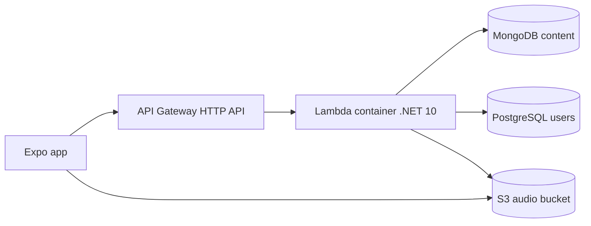

# Backend (.NET Web API on AWS Lambda)

The `backend/` folder at the repo root is the future home of the ASP.NET Core Web API. **No application code yet** — this doc defines how it should be built, run locally in Docker, and deployed.

## Role

Serve the React Native app:

- Masonry Home feed (`/v1/home/feed`) with image + title cards
- Story detail + coverage cluster payload for the full-screen outlet pager
- Storylines (timelines)
- Google Sign-In → PostgreSQL user + topic preferences
- Short-lived audio URLs for Opus objects in S3

Do **not** run Ollama, Kokoro, RSS polling, or Redis consumers inside Lambda.

## Recommended shape

| Choice | Recommendation |
| --- | --- |
| Runtime | .NET 10 (LTS; Lambda managed runtime + `public.ecr.aws/lambda/dotnet:10`) |
| Target framework | `net10.0` |
| Style | Minimal APIs or thin controllers + services |
| Hosting | AWS Lambda **container image** + API Gateway HTTP API |
| Local cloud sim | Docker image with Lambda **Runtime Interface Emulator (RIE)** |
| Content data | MongoDB driver (`MongoDB.Driver`) |
| User data | PostgreSQL (`Npgsql` / EF Core) |
| Auth | Verify Google ID token; issue app JWT |
| Audio | AWSSDK.S3 `GetPreSignedURL` (or CloudFront signed URLs later) |
| Config | Environment variables / AWS Secrets Manager |
| Template | `dotnet new serverless.image.AspNetCoreWebAPI` (Amazon.Lambda.Templates; prefer .NET 10) |

## Folder intent (when code lands)

```text
backend/
  README.md                 ← pointers (exists now)
  CNews.Api/                ← Web API + Lambda entry point
  CNews.Api.Tests/
  Dockerfile
  aws-lambda-tools-defaults.json
```

## Local simulation with Docker

AWS ships RIE inside the Lambda base images. Pattern:

1. Build the API image from `backend/Dockerfile`.
2. Run:

   ```text
   docker run --rm -p 9000:8080 \
     -e MONGODB_URI=… \
     -e S3_BUCKET=… \
     -e S3_ENDPOINT=… \
     cnews-api:dev
   ```

3. Invoke through the RIE endpoint (Lambda-shaped events), **or** for day-to-day mobile dev prefer a second local profile:

   - `dotnet run` (Kestrel on `http://0.0.0.0:5080`) for Expo Go on your LAN
   - Docker RIE when validating “this will work on Lambda”

RIE invoke example shape:

```text
POST http://localhost:9000/2015-03-31/functions/function/invocations
```

Body: API Gateway proxy event with `path`, `httpMethod`, `queryStringParameters`, etc.

### Why both Kestrel and RIE?

| Mode | Best for |
| --- | --- |
| `dotnet run` / compose “api” service on 5080 | Expo Go on phone, rapid iteration |
| Container + RIE on 9000 | Catching Lambda packaging and cold-start issues before deploy |

## Docker Compose place in the wider stack

See [local-development.md](./local-development.md). Backend service depends on:

- `mongo`
- `minio` (S3 API)
- optional `createbuckets` init container

It does **not** depend on Ollama.

## AWS deploy sketch



Notes:

- MongoDB for content (Atlas or Compose); PostgreSQL for users (RDS or Compose).
- Put Lambda in a VPC only if DB requires private networking; that increases cold start — prefer managed DB with IP allowlist / PrivateLink later.
- Image lives in **ECR**; Lambda points at the image URI.
- Stage names: `dev`, `staging`, `prod`.

## Configuration

| Name | Example | Purpose |
| --- | --- | --- |
| `MONGODB_URI` | `mongodb://…` | Content store |
| `MONGODB_DATABASE` | `cnews` | DB name |
| `POSTGRES_CONNECTION` | `Host=…;Database=cnews;…` | Users / prefs |
| `GOOGLE_CLIENT_IDS` | iOS/Android/Expo client ids | Token audience check |
| `JWT_SIGNING_KEY` | secret | App access tokens |
| `S3_BUCKET` | `cnews-audio-dev` | Opus bucket |
| `S3_REGION` | `ca-central-1` | Signing region |
| `S3_ENDPOINT` | empty on AWS; MinIO URL locally | Custom endpoint |
| `S3_FORCE_PATH_STYLE` | `true` for MinIO | SDK quirk |
| `AUDIO_URL_TTL_SECONDS` | `900` | Signed URL lifetime |
| `CORS_ORIGINS` | Expo / `*` in private dev | Browser not required; still set sanely |
| `ASPNETCORE_ENVIRONMENT` | `Development` | Logging |

## API surface

Defined in [api.md](./api.md). Keep handlers thin; validate once; map Mongo/Postgres → DTO explicitly.

## Auth

| Phase | Approach |
| --- | --- |
| Dev | Google Sign-In against local API + Compose Postgres; guest browse OK |
| Friends / TestFlight | Same Google path; require login for preference sync |
| Later | Optional Sign in with Apple alongside Google |

## Performance guidelines

- Home feed: indexed `{ topic, publishedAt }` queries with cursors (not `$sample` for the masonry wall).
- Projection: never return full article body; include `imageUrl` + short `summaryPreview`.
- Signed URL generation per play request; keep payloads tiny for cellular.

## Testing expectations (when code exists)

- Unit tests for topic filter parsing, Google token validation (mocked), DTO mapping.
- Integration tests against Compose Mongo + Postgres + MinIO.
- Smoke: RIE invoke → `GET /v1/home/feed`; `POST /v1/auth/google` with a test double.

## Non-goals

- Admin CMS UI
- Writing back into the ingestion working store
- Running TTS or LLM calls
- Long-lived WebSockets (v1 is request/response; add later if live tickers matter)
