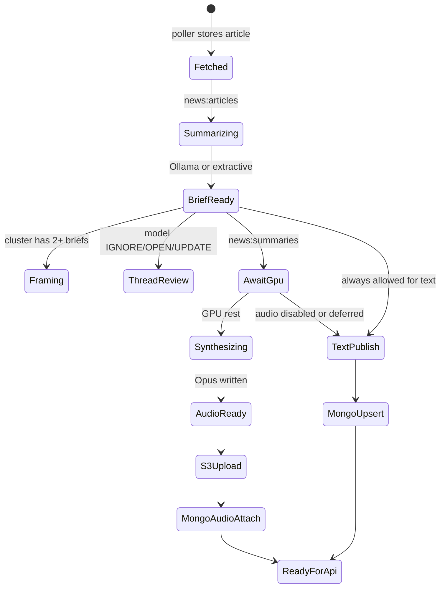

# Ingestion pipeline

How `realtime_ingestion` turns an RSS item into a mobile-ready brief and optional spoken Opus file.

## Prerequisites on the GPU / ingest host

1. Install [Ollama](https://ollama.com) and pull the 8B model:

   ```text
   ollama pull llama3.1:8b
   ```

2. Confirm the API:

   ```text
   curl http://127.0.0.1:11434/api/tags
   ```

3. Install Kokoro-82M (or the project’s chosen Kokoro runtime) with a voice suitable for short news briefs (current default voice name in code: `af_heart`).
4. Have Redis available (or accept in-process fakeredis for solo local runs).
5. Have publish targets reachable: MongoDB and S3 (or MinIO in Docker).

Without Ollama, briefs degrade to extractive text. Without Kokoro, stories stay text-only.

## Stages



### 1. Poll and store

Unchanged intent from today’s poller:

- Conditional HTTP fetch (`ETag` / `Last-Modified` / body hash).
- Parse RSS; skip known URLs; enrich short bodies with one HTML fetch.
- Redis seen-keys per feed; SQLite (working store) insert + cluster assignment.
- `XADD` article id onto `news:articles`.

### 2. Summarize first (required)

The AI worker:

1. Reads one `news:articles` message.
2. Calls Ollama chat with a strict “~50 plain words” prompt.
3. Saves `summary`, `summaryWords`, `summaryEngine`.
4. Acknowledges the stream message.
5. Enqueues `news:summaries` for TTS **after** a non-empty brief exists.
6. May run framing and thread logic next (still text-side; no GPU speech yet).

**Rule:** Never start Kokoro for an article that has no brief.

### 3. GPU rest gate (before Kokoro)

Kokoro and Ollama both want GPU/accelerator time. Contended inference causes timeouts and garbled audio.

**Gate policy (v1):**

| Check | Pass if |
| --- | --- |
| Brief exists | `summary` non-empty |
| Ollama idle | No in-flight chat requests from this process (and optional `/api/ps` empty) |
| Kokoro idle | No active synthesis job |
| Optional VRAM | Free memory above a configured threshold when `nvidia-smi` / Metal stats are available |
| Backoff | If busy, sleep 2–15s with jitter and re-check; do not ack the TTS message until success or permanent skip |

Only one Kokoro job runs at a time on a host. Ollama brief/framing/thread work has priority over starting new TTS jobs.

### 4. Synthesize Opus

When the gate passes:

1. Prepare speech text (normalize numbers, strip URLs — existing `prepare_speech_text` intent).
2. Run Kokoro with the configured voice.
3. Encode **Opus** (recommend 24–32 kbps mono for brief length).
4. Write a temp file, then upload.

If Kokoro is not installed: set `audioStatus = unavailable`, ack the message, do not block text publish.

### 5. Publish to MongoDB and S3

**Recommended ordering**

1. Upsert the story summary document in MongoDB as soon as the brief is final (`audioStatus = pending | unavailable`).
2. Upload Opus to S3 under a deterministic key (see [data-model.md](./data-model.md)).
3. Patch the MongoDB document: `audioKey`, `audioStatus = ready`, `audioContentType = audio/opus`, `publishedAt` if not set.

**Strict listen mode (optional flag):** delay API visibility until step 3 succeeds. Default for Home “listen” sampling is to include `audioStatus = ready` only; text Home may include `pending`.

**Atomicity.** There is no distributed transaction. Use:

- Idempotent S3 puts (same key).
- Idempotent Mongo upserts on `storyId`.
- A `publishAttempts` counter and dead-letter log on repeated failure.

### 6. Framing and threads (text side)

These enrich MongoDB collections the Home **coverage pager** and the **Storylines** tab read. They do not require Opus.

- **Framing (Coverage):** when a cluster has ≥2 briefs, write one sentence per outlet into `framings` / embedded compare docs (consumed via horizontal full-screen pages on Home).
- **Storylines:** model returns `IGNORE` | `OPEN` | `UPDATE`; maintain thread documents and ordered updates.

Publish framing/thread docs independently of audio readiness.

## Working store vs publish store

| Store | Holds | Consumers |
| --- | --- | --- |
| SQLite (today) | In-flight articles, feeds, events, local reader | Pipeline + temp UI |
| Redis Streams | Work queues | Workers only |
| MongoDB | Published stories, compare, threads | Lambda API |
| S3 | Opus bytes | App via signed URL |

Migration note: until Mongo publish is implemented, the local reader continues to read SQLite. After publish lands, the mobile app must not depend on SQLite.

## Configuration (planned env)

| Variable | Purpose |
| --- | --- |
| `OLLAMA_URL` | Default `http://127.0.0.1:11434` |
| `OLLAMA_MODEL` | Default `llama3.1:8b` |
| `KOKORO_VOICE` | e.g. `af_heart` |
| `TTS_ENABLED` | `true` / `false` |
| `GPU_GATE_ENABLED` | Default `true` |
| `MONGODB_URI` | Publish target |
| `S3_ENDPOINT` | AWS or MinIO URL |
| `S3_BUCKET` | Audio bucket |
| `S3_PREFIX` | e.g. `audio/opus/` |
| `REDIS_URL` | Stream broker |
| `PUBLISH_REQUIRE_AUDIO` | If `true`, hide from listen APIs until Opus ready |

## Observability

Emit structured events (also fine in the existing `events` table for local):

- `brief_ready`, `gpu_wait`, `tts_start`, `tts_done`, `mongo_upsert`, `s3_put`, `publish_ready`, `publish_failed`.

The temporary reader can keep showing these for developers. Mobile users never see them.

## Acceptance checklist

- [ ] `ollama pull llama3.1:8b` documented and verified on a clean machine.
- [ ] Brief always precedes TTS enqueue.
- [ ] Busy GPU delays TTS without dropping the brief.
- [ ] Opus lands in S3; MongoDB references the key.
- [ ] Text-only path works when TTS is off.
- [ ] Coverage pager data and Storylines update without waiting on audio.
