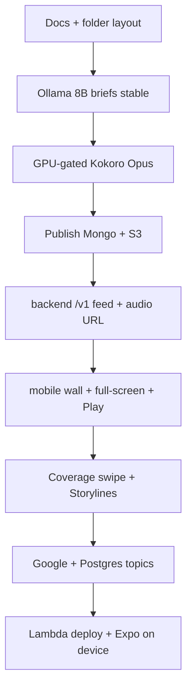
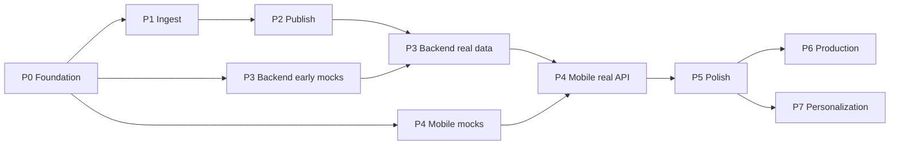

# Ultra roadmap

End-to-end plan for CNews: ingest → publish → API → mobile.  
Checkboxes are delivery steps. Items marked **CRITICAL** block the next phase or the user-visible loop.

Related specs: [features.md](./features.md) · [mobile.md](./mobile.md) · [api.md](./api.md) · [pipeline.md](./pipeline.md) · [backend.md](./backend.md)  
Living status: [SHIPPED.md](./SHIPPED.md) · Dev handbook: [DEV.md](./DEV.md) · Future prefs/recs: [upgrade-plan.md](./upgrade-plan.md)

---

## Repo layout (independent projects)

Three implementation roots. Docs stay under `docs/real-time-ingestion/`. **Do not nest** `mobile` inside `backend` or vice versa.

```text
cnews/
├── docs/real-time-ingestion/   # specs only
├── realtime_ingestion/         # Python pipeline (GPU host)
├── backend/                    # .NET 10 Web API → Lambda  (independent)
└── mobile/                     # React Native + Expo         (independent)
```

| Folder | Owns | Does not own |
| --- | --- | --- |
| `realtime_ingestion/` | RSS, Ollama, Kokoro, Redis, publish to Mongo/S3 | HTTP for phones, UI |
| `backend/` | `/v1` API, Google auth, Postgres users, signed audio URLs, Lambda/Docker | Ingest, TTS, Expo UI |
| `mobile/` | Expo app, custom theme, Zustand, device SQLite, UX | Mongo writes, GPU, Lambda packaging |

**Contract between backend ↔ mobile:** [api.md](./api.md) only.  
**Contract between ingest ↔ backend:** MongoDB + S3 shapes in [data-model.md](./data-model.md).

Parallelism: after Phase 0, **backend** and **mobile** may proceed on separate tracks using mocks/stubs. They integrate when `/v1/home/feed` returns real published stories.

---

## Critical path (do not skip)



| # | Critical milestone | Blocks |
| --- | --- | --- |
| C1 | Ollama briefs reliable | Worthless feed / audio |
| C2 | Summary-before-TTS + GPU gate | Contended GPU / bad audio |
| C3 | Story in Mongo + Opus in S3 | API has nothing to serve |
| C4 | `GET /v1/home/feed` + audio-url | Mobile cannot leave mocks |
| C5 | Wall → full-screen → Play on device | No product demo |
| C6 | Coverage swipe + Storylines | Differentiator incomplete |
| C7 | Google → Postgres prefs | No synced personalization |
| C8 | Lambda `dev` + physical Expo Go | Not shippable beyond LAN hacks |

Everything else is important but can slip without killing the loop.

---

## Feature → phase map

| ID | Feature | Phase | Critical? |
| --- | --- | --- | --- |
| F1 | Continuous RSS ingest | P1 (exists; harden) | Yes |
| F2 | Ollama 8B briefs | P1 | **CRITICAL** |
| F3 | GPU-gated Kokoro → Opus | P1–P2 | **CRITICAL** |
| F4 | Publish gate Mongo + S3 | P2 | **CRITICAL** |
| F5 | Immersive Home wall + full-screen | P4 | **CRITICAL** |
| F5b | Center Play queue (wall L→R) | P4 | **CRITICAL** |
| F6 | Topic preferences | P3–P4 | Yes |
| F7 | Coverage in Home swipe | Deferred | Soft (API done; UI postponed) |
| F8 | Storylines tab | P4 | Yes |
| F9 | .NET 10 Lambda backend | P3 | **CRITICAL** |
| F10 | Human-friendly UX polish | P4–P5 | Soft |
| F11 | Docker local simulation | P2–P3 | Yes |
| F12 | Google login + Postgres | P3–P4 | Yes |

---

## Phase 0 — Foundation (docs & folders)

**Goal.** Specs and independent project homes exist; no ambiguity about where code lives.

### Steps

- [x] Colocate `realtime_ingestion/` + `requirements.txt`
- [x] Full docs under `docs/real-time-ingestion/`
- [x] Reserve `backend/` (independent) with README
- [x] Mobile UX + API + data-model locked in docs
- [x] Reserve `mobile/` (independent) with README
- [x] Root `docker-compose.yml` (mongo, postgres, redis; MinIO via `--profile audio`)
- [x] Seed script + root README runbook

**Exit.** Anyone can point to the three folders and the ultra roadmap.

---

## Phase 1 — Ingest intelligence (`realtime_ingestion/`)

**Goal.** Stable briefs and speech scheduling on a GPU-capable host. Temporary HTML reader remains for ops only.

### CRITICAL steps

- [ ] **C1** Document + verify `ollama pull llama3.1:8b` on a clean machine ([local-development.md](./local-development.md)) *(operator)*
- [x] **C1** AI worker always produces non-empty brief (Ollama or extractive fallback) before enqueueing TTS
- [x] **C2** GPU rest gate: no Kokoro while Ollama busy; single TTS job; backoff/jitter ([pipeline.md](./pipeline.md))
- [x] **C2** Encode **Opus** via ffmpeg when available (WAV fallback)

### Other steps

- [x] Preserve / extract `imageUrl` from RSS/HTML for masonry cards
- [x] Emit events: `brief_ready`, `gpu_wait`, `tts_start`, `tts_done`
- [x] Framing + storyline decisions still run on text side (no audio dependency)
- [x] Keep poll caps so the 8B model does not fall behind (F1)

**Exit.** New RSS item → brief in working store; with Kokoro installed and GPU free → Opus file on disk; GPU busy → brief waits without crashing.

**Owner folder:** `realtime_ingestion/` only.

---

## Phase 2 — Publish path (`realtime_ingestion/` + Compose)

**Goal.** Mobile-ready documents in MongoDB; Opus in S3/MinIO.

### CRITICAL steps

- [x] Compose up: `mongo`, `postgres`, `redis` (MinIO optional `--profile audio`)
- [x] **C3** Publisher: upsert `stories` (summary, `imageUrl`, topics, cluster/thread ids, `audioStatus`)
- [x] **C3** Upload Opus/WAV → S3 key layout; patch Mongo `audioKey` / `audioStatus=ready`
- [x] **C3** Publish gate + retries + `publish_deadletters`
- [x] Publish coverage (`compares`) and storylines (`threads`) docs independently of audio

### Other steps

- [x] Env: `MONGODB_URI`, `S3_*`, `PUBLISH_REQUIRE_AUDIO`, `TTS_ENABLED`
- [x] Idempotent upserts (safe re-run)
- [x] Seed script for API/mobile without waiting on live RSS (`scripts/seed_demo_mongo.py`, `scripts/seed_demo_ads.py`)

**Exit.** After one poll cycle, Mongo has a `textReady` story; listen-ready stories have S3 Opus.

**Owner folder:** `realtime_ingestion/` (+ repo-root Compose). Backend/mobile still unused.

---

## Phase 3 — Backend (`backend/` independent)

**Goal.** Phone-reachable `/v1` API. Can start with **seed/fixture data** before P2 finishes; switch to real Mongo when C3 is green.

### CRITICAL steps

- [x] Scaffold .NET 10 Lambda container Web API inside `backend/` (not under `mobile/`)
- [x] **C4** `GET /v1/home/feed` (topics, cursor, `newerThan`, `imageUrl`, `summaryPreview`)
- [x] **C4** `GET /v1/stories/{id}` + `GET /v1/stories/{id}/audio-url` (signed S3/MinIO)
- [x] `GET /v1/coverage/{clusterId}` for full-screen pager
- [x] `GET /v1/storylines` + `GET /v1/storylines/{id}`
- [x] `GET /v1/meta/topics` + `GET /v1/health`
- [x] Kestrel for Expo LAN; Dockerfile for Lambda RIE
- [x] Wire Mongo (+ S3 when available) from Compose

### Auth / users (can trail feed by a few days, still required before P4 exit)

- [x] Postgres schema: `users`, `user_preferences`
- [x] `POST /v1/auth/google` (verify ID token → JWT; `dev:email` bypass in Development)
- [x] `GET /v1/me`, `PUT /v1/me/topics`
- [x] Guest browse without JWT still allowed for feed

### Deploy track

- [ ] **C8a** ECR image + Lambda + HTTP API `dev` stage *(AWS account)*
- [ ] Secrets: Mongo, Postgres, JWT, Google client ids, S3 *(AWS)*

**Exit.** From a phone on Wi‑Fi: `GET /v1/home/feed` against Kestrel; RIE smoke passes; optional `dev` URL live.

**Owner folder:** `backend/` only. Consumes Mongo/S3/Postgres; never imports Python or Expo code.

---

## Phase 4 — Mobile (`mobile/` independent)

**Goal.** Product UX on Expo Go. Can begin against **Mock Service Worker / static fixtures** in parallel with P3; cut over to real API for exit.

### CRITICAL steps

- [x] Scaffold Expo (SDK 57) in `mobile/` — Expo Router, Zustand, SQLite (custom polished UI; HeroUI/Uniwind optional later)
- [x] Tabs: **Home · Play · Storylines · Settings** (no Coverage tab)
- [x] **C5** Immersive wall: staggered masonry, no app-name top bar, image/text cards
- [x] **C5** Tap → full-screen reader; swipe-down / back → wall
- [x] **C5** Center Play: visible wall cards; page-scoped queues; pause/progress/highlight
- [x] Pull-to-refresh → fresh shuffled page; scroll down → cursor `loadMore`
- [x] Feed pagination via SQLite then network
- [ ] **C6a** Coverage horizontal pager — **deferred** (API + seed exist; separate Home cards OK)
- [x] **C6b** Storylines list (Ongoing/Closed/All) + outlet timeline (stamp · spine · cards)
- [x] Storylines cursor pagination + shuffle refresh (API + client)
- [x] Original WebView pause/resume Play (Home + Storylines)
- [x] Background / lock-screen audio (`expo-audio` plugin; needs native rebuild)
- [x] Settings topics only; Home always `mode=listen`
- [x] Display ads: story-like cards on Home + Storylines (`GET /v1/ads/display`)
- [x] **C7** Google Sign-In stub → JWT (`dev:` or real token); sync topics via `/v1/me/topics`
- [ ] Point `EXPO_PUBLIC_API_BASE_URL` at LAN backend; validate iOS + Android phones *(operator device)*

### Other steps

- [x] Sync engine: SQLite-first paint, remote merge ([mobile.md](./mobile.md))
- [x] Signed URL refresh path in player/API client
- [x] Empty/skeleton/offline mock fallback
- [x] CrackNews branding, system dark mode, typographic C icon / splash
- [ ] Deep link stubs (optional)

**Exit.** [mobile.md](./mobile.md) acceptance walkthrough passes on a physical device against real (or Compose-backed) backend.

**Owner folder:** `mobile/` only. Depends on HTTP + [api.md](./api.md); no shared runtime with `backend/` or `realtime_ingestion/`.

---

## Phase 5 — Harden & polish (all folders)

**Goal.** Demo-quality reliability; remove training wheels.

### Steps

- [x] Audio: page-scoped Play (stop on leave); Original pause/resume; lock-screen path
- [ ] Optional: revisit F7 coverage swipe if product wants compare again
- [ ] Stronger offline: last wall page readable without network
- [ ] API: rate limits, better error envelope, cursor stability
- [ ] Ingest: retention hooks; dead-letter dashboard or log scrape
- [ ] Privacy-light analytics (play start/complete, topic changes) — feeds [upgrade-plan.md](./upgrade-plan.md) U3
- [ ] Retire temporary HTML reader for external demos (keep for pipeline ops if useful)
- [ ] Backend + mobile CI (build/test) in their own folders
- [ ] **C8b** Expo / EAS against deployed Lambda `dev` (not only LAN)
- [ ] Native rebuild validating background audio on device

**Exit.** Teammate can clone, Compose up, run ingest + `backend` + `mobile` from [DEV.md](./DEV.md) alone.

---

## Phase 6 — Production scale (later)

**Goal.** Real users, real cost control.

### Steps

- [ ] CloudFront (or equivalent) in front of audio
- [ ] Mongo + Postgres indexes under load; connection pooling on Lambda
- [ ] Dedicated ingest/GPU host (VM or always-on Mac mini) + health checks
- [ ] S3 lifecycle / retention aligned with feed window
- [ ] Monitoring/alerts: publish lag, TTS backlog, API 5xx, auth failures
- [ ] Push notifications — **only if** users ask
- [ ] App Store / Play packaging (leave Expo Go)

**Exit.** `prod` stage with runbooks; ingest and API SLOs defined.

---

## Phase 7 — Personalization (future — do not start yet)

**Goal.** Signed-in users subscribe to outlets and get a ranked For You feed.  
Full plan: [upgrade-plan.md](./upgrade-plan.md).

### Steps (summary)

- [ ] U0 Production Google OAuth (no `dev:` outside Development)
- [ ] U1 Expanded preferences API (`preferredOutlets`, mutes, places)
- [ ] U2 Outlet subscribe / mute → filter + boost in Home feed
- [ ] U3 Privacy-light play/open signals → affinity tables
- [ ] U4 Interpretable `for_you` ranker (`GET /v1/home/feed?mode=for_you`)
- [ ] U5 Optional digests / “more like this” / storyline follow

**Exit.** Dogfood shows subscribed outlets on screen 1; guests unchanged.

---

## Parallel work board

| Track | Can start when | Primary folder |
| --- | --- | --- |
| Ingest harden (P1) | Now | `realtime_ingestion/` |
| Publish (P2) | After C1 (briefs exist) | `realtime_ingestion/` |
| Backend scaffold + fixtures (P3 early) | After Phase 0 | `backend/` |
| Backend real Mongo (P3) | After C3 | `backend/` |
| Mobile UI against mocks (P4 early) | After Phase 0 | `mobile/` |
| Mobile against real API (P4) | After C4 | `mobile/` |
| Google/Postgres (P3–P4) | After feed works | `backend/` + `mobile/` |
| Lambda deploy | After C4 locally green | `backend/` |

Suggested staffing if solo: **P1 → P2 → P3 feed → P4 wall/Play → coverage/storylines → auth → deploy**.  
If two people: **A = ingest+publish**, **B = backend+mobile mocks**, integrate at C3/C4.

---

## Definition of Done — first public demo

All of the following:

1. **CRITICAL** Ollama brief + Opus publish for at least one live Canadian feed  
2. **CRITICAL** `backend` serves `/v1/home/feed` + signed audio from Compose or `dev`  
3. **CRITICAL** `mobile` wall → full-screen → back; center Play speaks ~4 visible cards  
4. ~~Coverage swipe~~ → **deferred**; multi-outlet still appears as separate Home cards  
5. One Storyline with Ongoing/Closed + outlet timeline  
6. Google login (`dev:` or real) stores user in Postgres and restores topics  
7. Runs from three independent folders with docs links only (no cross-folder code imports)

---

## Dependency graph (phases)



---

## Decision log (living)

| Date | Decision |
| --- | --- |
| 2026-10-10 | Mobile = React Native + Expo; brand = **CrackNews** |
| 2026-10-10 | Backend = .NET 10 Web API on Lambda containers |
| 2026-10-10 | Audio = Opus/m4a; content = MongoDB; users = PostgreSQL |
| 2026-10-10 | Summary before Kokoro; Kokoro only on GPU rest |
| 2026-10-10 | Docs live under `docs/real-time-ingestion/` |
| 2026-10-10 | Home = immersive staggered masonry wall (no app-name top bar) |
| 2026-10-10 | Tap card → in-tab full-screen reader above tab bar |
| 2026-10-10 | Coverage horizontal swipe **deferred**; separate Home cards OK |
| 2026-10-10 | Tabs: Home, Storylines, center Play, Settings, Login |
| 2026-10-10 | State = Zustand; cache = SQLite; custom theme (not HeroUI yet) |
| 2026-10-10 | Login = Google (`dev:` bypass); guest browse allowed |
| 2026-10-10 | `backend/` and `mobile/` are **independent** sibling folders |
| 2026-10-10 | Play is page-scoped; Original pauses/resumes; lock-screen audio planned |
| 2026-10-10 | Pull refresh = shuffle fresh page (Home + Storylines) |
| 2026-10-10 | Future: outlet subscribe + For You ranker — [upgrade-plan.md](./upgrade-plan.md) |
| 2026-10-17 | Display ads as in-feed cards (not Play / not audio); Settings topics only |
